# CSE 114 Lab Report: Pattern Programs Using Nested `for` Loops in C


Lab report programs for **CSE 114** at the **University of Science and Technology Chittagong**.
The repository contains 12 C programs that print patterns using nested `for` loops. Each experiment lives in its own folder with its source code and screenshots.

## Course Information

| | |
|---|---|
| **University** | University of Science and Technology Chittagong |
| **Course Code** | CSE 114 |
| **Batch** | 47(C) |
| **Course Teacher** | Umme Aiman Jannat |
| **Student Name** | Mohammed Minhajur Rahman Khan |
| **Student ID** | 0022620005101101 |

## Repository Structure

```text
cse114-pattern-programs/
├── experiment-01/
│   ├── main.c
│   └── screenshot/
│       ├── code.png
│       ├── output_sample.png
│       └── output_custom.png
├── ...                      (same layout for experiments 02-12)
├── .gitignore
└── README.md
```

## Environment

| | |
|---|---|
| **OS** | Windows 11 |
| **Compiler** | Clang 23.1.3 (LLVM-MinGW, `x86_64-w64-windows-gnu`) |
| **Shell** | PowerShell 7 |

Any standard C17 compiler (Clang or GCC) will work.

## Build and Run

Compile and run any experiment from inside its folder, for example:

```powershell
cd experiment-01
clang --std=c17 -Wall -Wextra -o experiment.exe main.c
.\experiment.exe
```

## Experiments

Click an experiment to expand its source link, code screenshot, and input/output screenshots.

<details>
<summary><b>Experiment 1: Right-Angled Triangle (Stars)</b></summary>

**Source file:** [`experiment-01/main.c`](experiment-01/main.c)

**Screenshot of code**

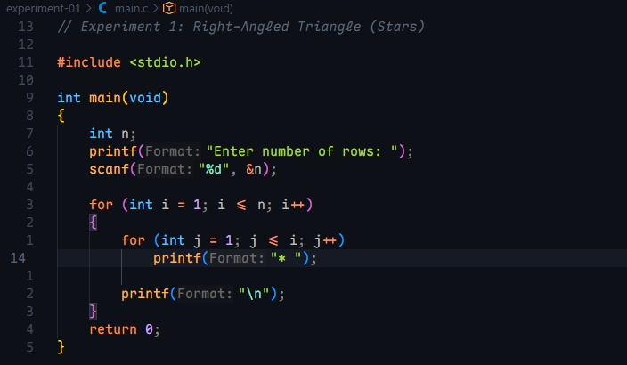

**Screenshot of input and output** (sample input: 5)

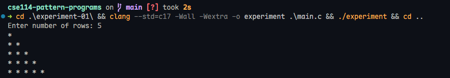

**Screenshot of input and output** (own input: 12)

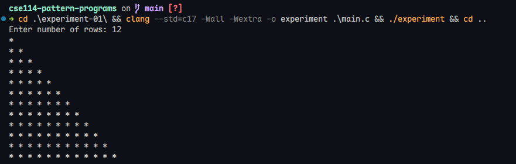

</details>

<details>
<summary><b>Experiment 2: Inverted Right-Angled Triangle</b></summary>

**Source file:** [`experiment-02/main.c`](experiment-02/main.c)

**Screenshot of code**

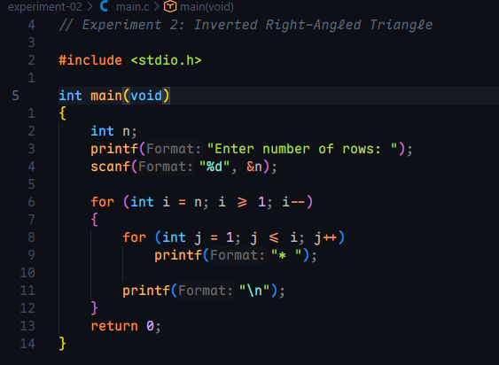

**Screenshot of input and output** (sample input: 5)

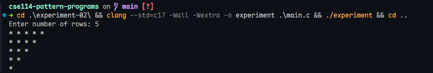

**Screenshot of input and output** (own input: 12)

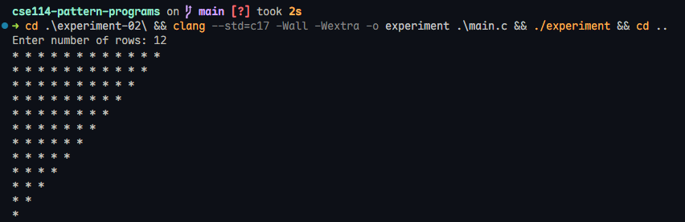

</details>

<details>
<summary><b>Experiment 3: Pyramid (Centered Triangle)</b></summary>

**Source file:** [`experiment-03/main.c`](experiment-03/main.c)

**Screenshot of code**

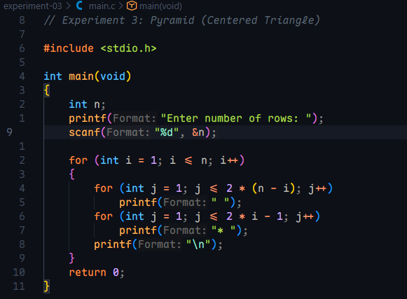

**Screenshot of input and output** (sample input: 5)

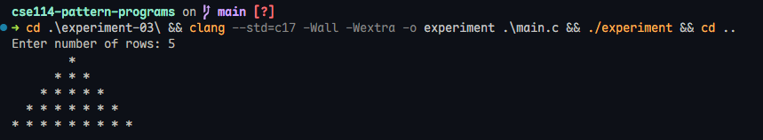

**Screenshot of input and output** (own input: 12)

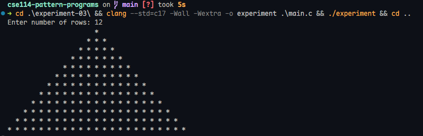

</details>

<details>
<summary><b>Experiment 4: Inverted Pyramid</b></summary>

**Source file:** [`experiment-04/main.c`](experiment-04/main.c)

**Screenshot of code**

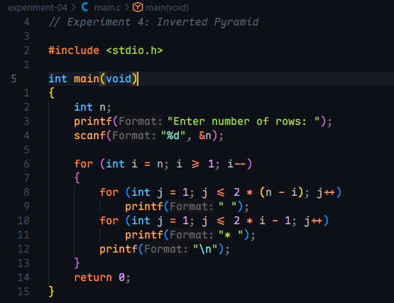

**Screenshot of input and output** (sample input: 5)

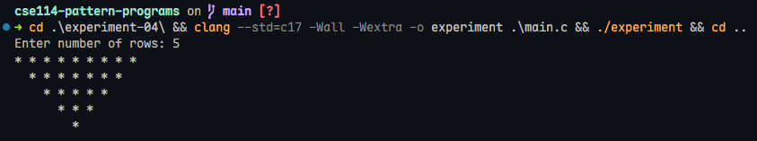

**Screenshot of input and output** (own input: 12)

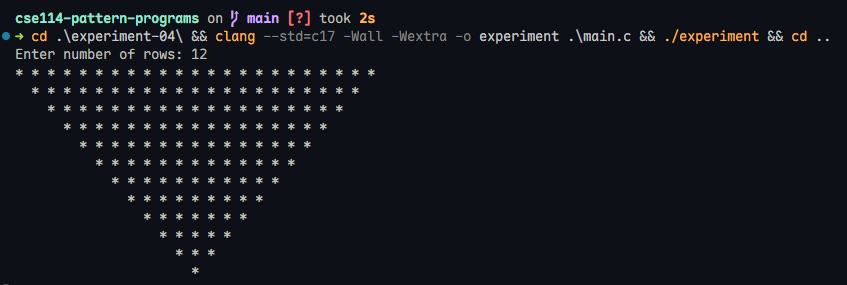

</details>

<details>
<summary><b>Experiment 5: Diamond Pattern</b></summary>

**Source file:** [`experiment-05/main.c`](experiment-05/main.c)

**Screenshot of code**

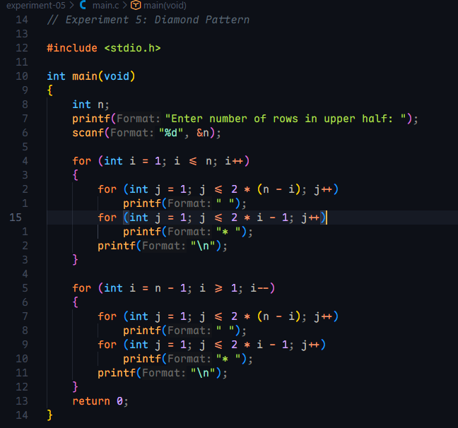

**Screenshot of input and output** (sample input: 4)

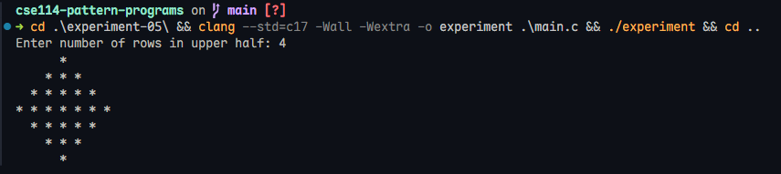

**Screenshot of input and output** (own input: 12)

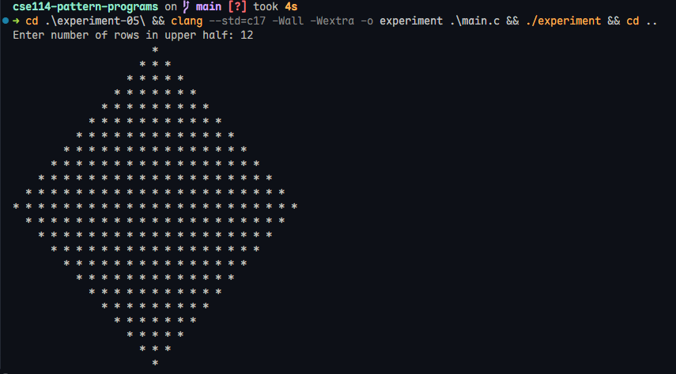

</details>

<details>
<summary><b>Experiment 6: Pascal's Triangle</b></summary>

**Source file:** [`experiment-06/main.c`](experiment-06/main.c)

**Screenshot of code**

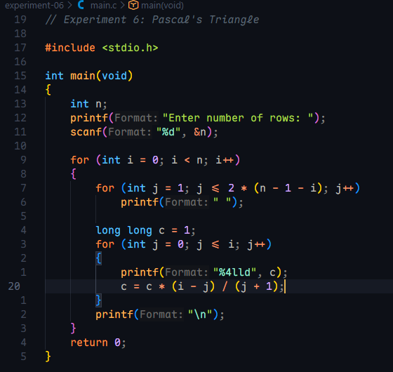

**Screenshot of input and output** (sample input: 5)

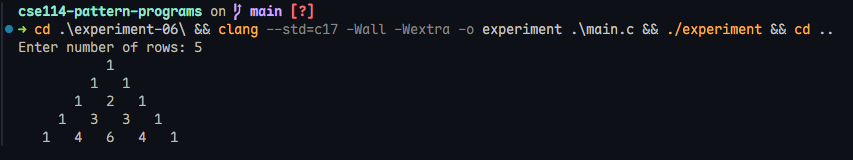

**Screenshot of input and output** (own input: 9)

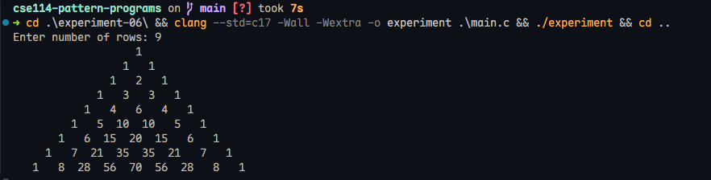

</details>

<details>
<summary><b>Experiment 7: Floyd's Triangle</b></summary>

**Source file:** [`experiment-07/main.c`](experiment-07/main.c)

**Screenshot of code**

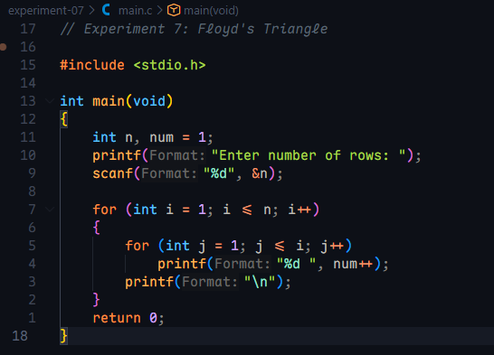

**Screenshot of input and output** (sample input: 5)

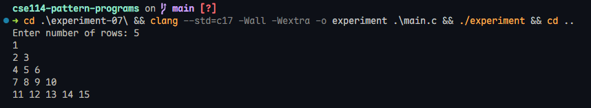

**Screenshot of input and output** (own input: 12)

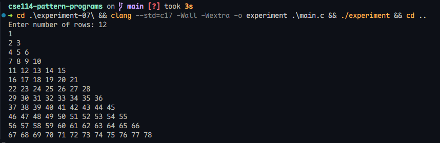

</details>

<details>
<summary><b>Experiment 8: Number Pyramid (1 to j Each Row)</b></summary>

**Source file:** [`experiment-08/main.c`](experiment-08/main.c)

**Screenshot of code**

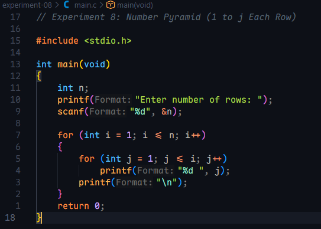

**Screenshot of input and output** (sample input: 5)

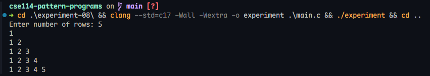

**Screenshot of input and output** (own input: 12)

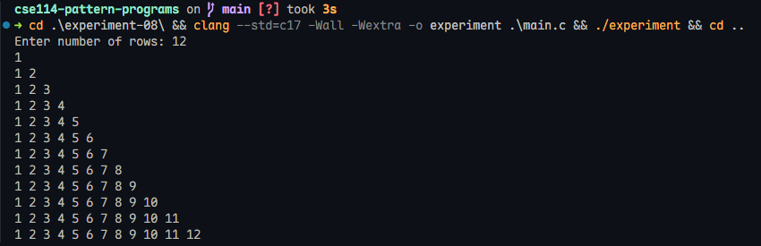

</details>

<details>
<summary><b>Experiment 9: Number Triangle (Row Number Repeated)</b></summary>

**Source file:** [`experiment-09/main.c`](experiment-09/main.c)

**Screenshot of code**

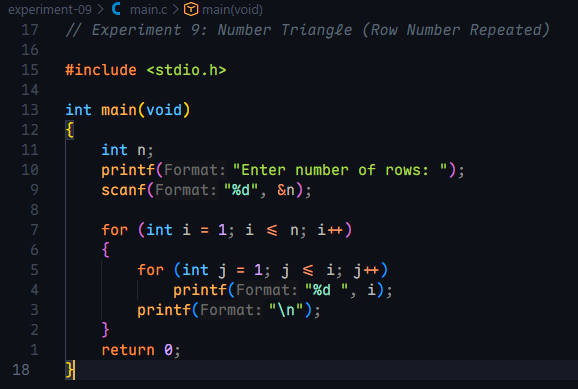

**Screenshot of input and output** (sample input: 5)

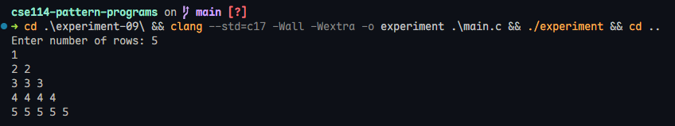

**Screenshot of input and output** (own input: 12)

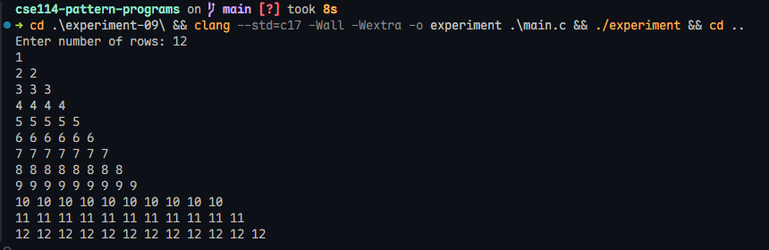

</details>

<details>
<summary><b>Experiment 10: Hollow Square</b></summary>

**Source file:** [`experiment-10/main.c`](experiment-10/main.c)

**Screenshot of code**

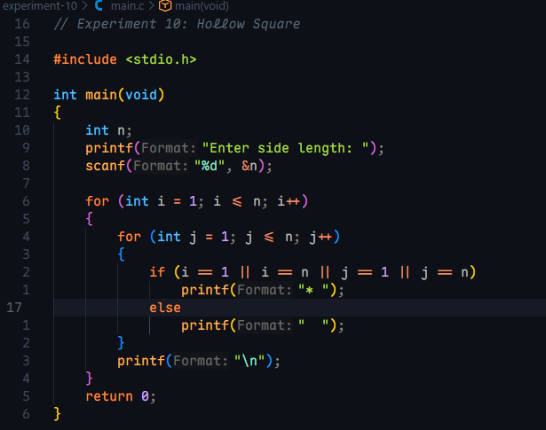

**Screenshot of input and output** (sample input: 5)

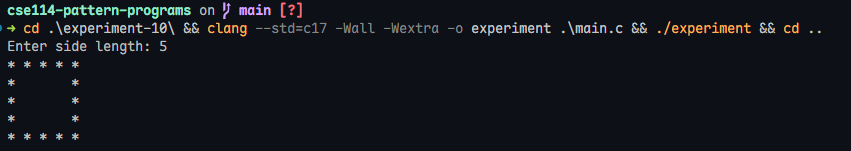

**Screenshot of input and output** (own input: 12)

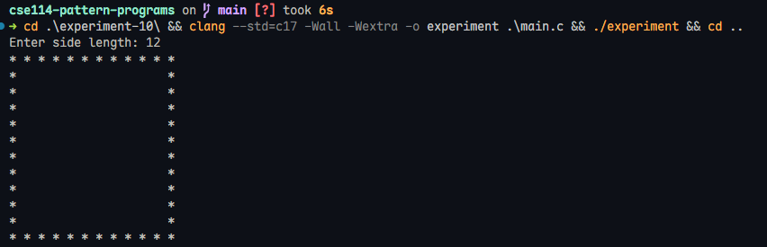

</details>

<details>
<summary><b>Experiment 11: Butterfly Pattern</b></summary>

**Source file:** [`experiment-11/main.c`](experiment-11/main.c)

**Screenshot of code**

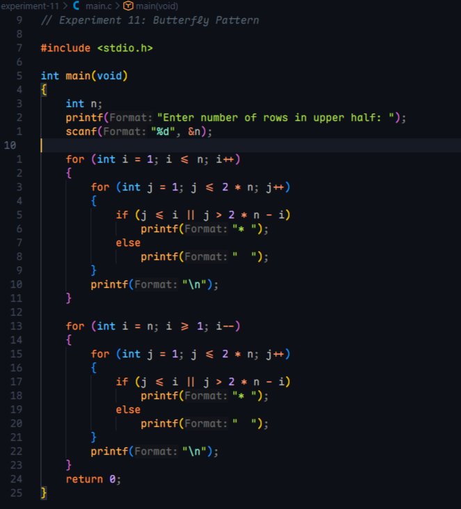

**Screenshot of input and output** (sample input: 4)

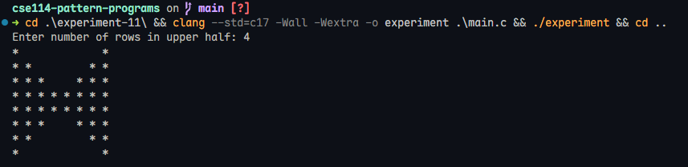

**Screenshot of input and output** (own input: 8)

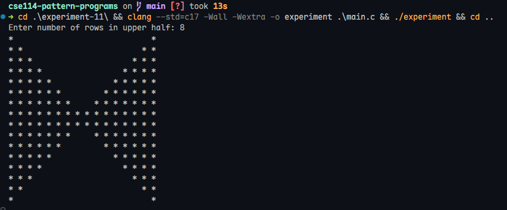

</details>

<details>
<summary><b>Experiment 12: Zigzag (W) Pattern</b></summary>

**Source file:** [`experiment-12/main.c`](experiment-12/main.c)

**Screenshot of code**

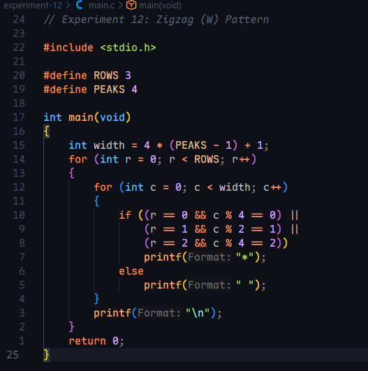

**Screenshot of output** (no input needed, size is fixed in the code)

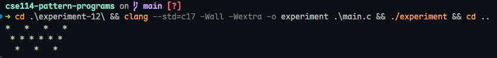

</details>

## Notes

- Every program is written with nested `for` loops and compiles without warnings under `clang --std=c17 -Wall -Wextra`.
- Programs 1-11 read the size from the user; Experiment 12 uses a fixed size (3 rows, 4 peaks).
- Each experiment was run with the sample input and with at least one additional value.